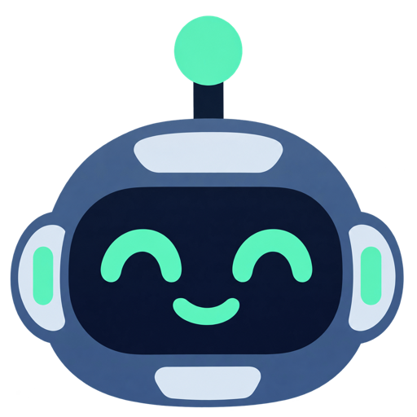

<div align="center">



<h1>Companion IA</h1>

**Your free, open-source digital companion. Yours to run, yours to configure, and yours to control.**

<p>
  <a href="https://github.com/fabianfaaaal/companion-ia/releases"></a>
  <a href="https://github.com/fabianfaaaal/companion-ia/releases/tag/android-alpha-0.1.0"></a>
</p>

[English](README.md) · [Español](README_spanish.md)

[Requirements](#system-requirements) · [Quick start](#quick-start) · [Roadmap](#roadmap)

</div>

Companion IA aims to give you a digital companion you can count on. It helps you learn, keeps track of what matters to you, and brings AI models and tools together in one place. **Tell Companion what you want to accomplish in plain language.** As capabilities become available, you can organize work, collaborate with Companion, or delegate a task.

Study for an exam and pick up where you left off. Organize references and work through a design together. Ask for an editable deliverable and review what Companion did. An optional personal journal is planned so you can revisit the progress, decisions, and experiences you choose to keep.

**The Windows app and Android app are free, with no Companion subscription.** Run models on your own PC with Ollama or connect your own account to an optional external API. Any API charges come from that provider.

You control your personal files and sensitive information. You choose what Companion can access, what it saves, and whether to share anything with an external provider. The Android alpha currently connects to your PC over the same Wi-Fi network. The model runs on the PC.

## What you can try today

| Feature | Available in the preview |
| --- | --- |
| Local AI chat | Chat with Ollama, customize Companion’s personality, and reopen conversations you chose to save. |
| Memory and context | Use notes, keyword-based context cards, and imported histories. Review suggested updates before accepting them. |
| Voice and dictation | Record by pressing a button with Whisper and listen with Piper or experimental Qwen TTS, depending on the build. |
| Personal archive | Save photos with descriptions in Cinemateca, set local reminders, and create or restore folder-based backups. |
| Models and tools | Connect an optional OpenAI or DeepSeek account, or explicitly authorize a web search. |
| Android companion | Scan a QR code and chat with your Windows PC on the same Wi-Fi network. |

Windows is a public preview. Android is a public alpha. Wi-Fi chat was verified on a physical phone during development. The full setup on a clean Windows PC still needs hands-on acceptance testing. Linux is covered by CI, with a distributable package planned.

## System requirements

### PC host

| Use | Hardware and software |
| --- | --- |
| Open the Windows preview | 64-bit Windows and space to extract the full ZIP. A dedicated GPU, microphone, and model are optional for launching the app. Minimum CPU and RAM for the app alone are still to be measured. |
| Light local text chat | Start with **8 GB RAM** and about **8 GB of free disk space**, using a small model such as `qwen2.5:1.5b` on the CPU. Ollama requires **Windows 10 22H2 or newer**. |
| Local chat and turn-based voice | Start with **16 GB RAM** and about **15 GB of free disk space**. Use a microphone for dictation and speakers or headphones for replies. A compatible GPU can accelerate inference. |
| Development reference PC | **Ryzen 9 3900XT, 32 GB RAM, RTX 3080 with 10 GB VRAM.** In one development check, `qwen3:4b` ran fully on GPU with a 4,096-token context. |
| Dedicated host target | **32–64 GB RAM**, **1–2 TB SSD**, and **16–32 GB VRAM**, depending on your models and applications. Workload validation is pending. |

RAM and disk figures are planning estimates. Ollama and model downloads need additional space as your model library grows. [Ollama for Windows](https://docs.ollama.com/windows)

### Android client

- **Android 6.0 (API 23) or later**, according to the current build configuration.
- **Camera** for QR pairing and **Wi-Fi on the same local network** as the PC in the current alpha.
- **Running Windows host** with compatible Companion and Ollama builds. The phone sends messages and displays replies. AI inference runs on the PC, so the phone needs no model download.

## Quick start

1. Download the [Windows preview ZIP](https://github.com/fabianfaaaal/companion-ia/releases), extract it in full, and open **CompanionIA.exe**.
2. Install Ollama and download a model. Start with `qwen2.5:1.5b` for lightweight text chat.
3. Select **Detect Ollama**, choose your model, and send a message. You can start with memory off.
4. To connect Android, open **Android** on the PC and generate a QR code. On your phone, open **Settings → Scan QR code**.

[Windows setup and Android pairing](docs/getting-started.md)

## Privacy and control

- **Optional memory.** Choose what Companion can save, review, and reuse.
- **Private mode.** Keep chat temporary and local. This mode disables access to saved memory, voice, sensors, external providers, and Android.
- **External services.** Enable only the providers and tools you want to use.
- **Local files.** The current personal archive is unencrypted. Use synthetic data when testing the preview. Archive encryption is on the roadmap.

## Roadmap

| Milestone | Planned scope |
| --- | --- |
| Setup | Clean Windows install · guided setup · local, online, and hybrid profiles |
| Continuity | Personal journal · resume across days · editable memory · encrypted archive |
| The Mind | Readable timeline · ask what happened · permissions · token usage |
| Agents | Assign · schedule · pause · resume · review · deliver · learn from feedback |
| Applications | Text → slides → spreadsheets → image creation and editing → Blender → video |
| Working together | Install approved tools · collaborate or delegate · review versions and deliverables |
| Android | Direct access over mobile data where supported · task status · alerts · approvals |
| Maintenance | Prepare updates · run checks · review before applying · rollback |

## Run from source

Use **Python 3.12**, Ollama, and a downloaded model. From the repository root in PowerShell:

```powershell
python -m venv .venv
.\.venv\Scripts\python.exe -m pip install -r requirements-build-windows.txt
$env:PYTHONPATH = "src"
.\.venv\Scripts\python.exe -m companion.desktop
```

Run the standalone reader or the test suite:

```powershell
powershell.exe -NoProfile -STA -File .\scripts\reader-windows.ps1
.\.venv\Scripts\python.exe -B -m unittest discover -s tests -v
```

## Documentation and help

- [Getting started](docs/getting-started.md)
- [Guided setup, context cards, and backups](docs/guided-preview.md)
- [Local voice setup](docs/voice-ready-preview.md)
- [Providers, accounts, and histories](docs/providers-and-history.md)
- [Build Android from source](android/README.md)
- [Report a reproducible issue](https://github.com/fabianfaaaal/companion-ia/issues)

## Maintainer and license

Maintained by [Fabián](https://github.com/fabianfaaaal) with help from Codex. Reproducible bug reports are welcome. External code contributions are currently paused.

Companion IA is licensed under [Apache-2.0](LICENSE). Models, voices, and dependencies have their own terms. [Third-party notices](THIRD_PARTY_NOTICES.md)
