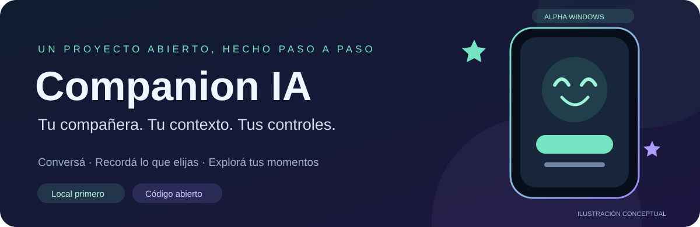

<div align="center">



**Una compañera digital para conversar, crear y volver a tus recuerdos. ✨**


**Alpha Windows · guardado inicial configurable · APIs externas con costos propios**

[Guía del preview Windows](docs/modern-chat-preview.md) · [La experiencia](#-la-experiencia) · [Qué funciona](#-qué-funciona-hoy) · [Probar](#-manos-a-la-obra) · [Cómo trabajamos](#-construido-con-ia-y-con-criterio)

</div>

## 💚 La experiencia

Companion IA explora una idea: **que cambiar de modelo no signifique empezar de cero con tu compañera**.

El programa organiza la personalidad, el contexto y los recuerdos que habilitás. Ollama puede generar la respuesta en tu PC; también hay adaptadores para DeepSeek y OpenAI con cuentas propias. La voz lee esa respuesta y el chat te muestra qué motor intervino.

Queremos que puedas charlar, trabajar, configurar una mascota o una compañera y explorar momentos desde una Memoteca. **Hay un prototipo para probar y bastante por construir.** La continuidad es una función del software; no implica conciencia ni comprensión infalible.

## 🚀 Qué funciona hoy

| Experiencia | Estado del preview |
|---|---|
| 💬 Chat con globos y emojis | Usuario a la derecha, companion a la izquierda, texto seleccionable |
| 🗂️ Conversaciones a mano | Lista lateral, guardado automático con memoria activa, abrir, renombrar y borrar |
| 🎛️ Perfiles de privacidad | Completo, Concentrado, Solo chat y perfiles configurables |
| 🔒 Chat privado | Solo chat local temporal; apaga memoria, percepción, voz y APIs externas |
| 🪄 Dispositivo flotante | Ventana compacta sin marco, acceso al programa completo y tres pieles |
| 🖼️ Memoteca independiente | Galería de fotos/descripciones en otra ventana, con los mismos permisos |
| 🧠 Contexto recuperable | Notas e historiales seleccionados, fuentes inspeccionables |
| 🔌 Modelos intercambiables | Ollama local; adaptadores DeepSeek/OpenAI y respaldo local informado |
| 🎭 Personalidad | Nombre, perfil, estilo e instrucciones propias |
| 🎙️ Voz y dictado | Piper o Qwen TTS opcional; Whisper local por botón |
| 🗓️ Agenda y alarmas | Avisos locales con aplicación abierta y controles activos |
| 🌐 Web y entorno | Búsqueda explícita y títulos de ventanas autorizados; sin cámara |

**Estado: alpha Windows.** Los adaptadores externos tienen pruebas sintéticas; una cuenta y su clave son necesarias para validar el servicio real. Linux tiene pruebas de código/interfaz en CI; todavía no se entrega un paquete Linux aceptado. Android está planificado.

### Lo que todavía estamos construyendo 🛠️

Tutorial de palabras clave, archivo íntimo cifrado, instalador unificado, sincronización de historiales, más proveedores y una Cinemateca con relatos/video. Cámara, interpretación visual y escucha continua no están integradas.

Qwen TTS está disponible como experimento de voz y resultó lento en la PC de referencia; Piper es la alternativa de menor demora. No prometemos conversación de voz en tiempo real.

## 🧭 Tus controles importan

El primer inicio normal trae funciones habilitadas, incluido el guardado del chat. **Las opciones que desmarcás y los perfiles elegidos se recuerdan.** Guardar, usar contexto y enviarlo a otro proveedor son decisiones distintas.

- **Memoria activa:** conserva los mensajes visibles del chat; notas, fotos e importaciones tienen sus controles.
- **Memoria apagada:** no accede al archivo conservado; el chat nuevo vive en esa sesión.
- **Modo privado:** prevalece sobre todos los perfiles. Solo queda un chat local temporal y se limpia al salir; no utiliza recuerdos, sensores, personalidad personalizada ni APIs externas.
- **API externa:** requiere cuenta, clave y autorización de sus posibles cargos. No hay compras ni recargas automáticas.
- **Micrófono:** permiso para pulsar Dictar; no es una grabadora ambiental permanente.

El archivo de recuerdos **todavía no está cifrado**. Usá información de prueba o general; no es una entrega preparada para almacenar intimidad real. Privado desconecta funciones, pero no borra por sí solo lo que ya guardaste. La cancelación no puede retirar datos ya enviados a un proveedor.

## 🧩 La cadena que estamos validando

**Tu mensaje → contexto permitido → preparación local → modelo elegido → respuesta visible → voz opcional.**

Si falla el proveedor externo, el programa puede continuar con Ollama usando el mismo contexto filtrado, y te informa el cambio. Una promesa del modelo no es un recibo de una acción ejecutada.

Los historiales importados conservan cuenta y autor. Una respuesta de otro asistente es un registro de conversación, no un hecho verificado sobre vos.

## 🏁 Manos a la obra

Esta etapa distribuye código y paquetes de prueba construidos localmente. **Todavía no hay instalador universal ni release estable.**

Guías:

- [Chat moderno, perfiles y dispositivo](docs/modern-chat-preview.md)
- [Proveedores, cuentas e historiales](docs/providers-and-history.md)
- [Preparar voz local](docs/voice-ready-preview.md)
- [Preparar Ollama en Windows](docs/setup-windows.md)

### Ejecutar desde código en Windows

Python 3.12 y Ollama con un modelo local descargado. Desde la raíz del repositorio, en PowerShell:

```powershell
python -m venv .venv
.\.venv\Scripts\python.exe -m pip install -r requirements-build-windows.txt
$env:PYTHONPATH = "src"
.\.venv\Scripts\python.exe -m companion.desktop
```

La voz necesita su entorno y modelos separados, según su guía. Por defecto se usa Ollama; una suscripción a una web de chat no concede automáticamente acceso a su API o historial.

Para construir el paquete de este hito:

```powershell
.\.venv\Scripts\python.exe scripts/build_windows.py --variant modern-chat-preview
```

## 🧪 Lo probado y lo que falta aceptar

La suite local más reciente tiene **239 pruebas aprobadas**, con datos sintéticos. Incluye permisos, persistencia, cancelación, transporte, filtros de contexto, perfiles y widgets.

```powershell
.\.venv\Scripts\python.exe -B -m unittest discover -s tests -v
```

También se verifican recorridos de ventanas y ejecutables. Las pruebas automatizadas no equivalen a aceptación de naturalidad de voz, experiencia visual, precisión del dictado ni disponibilidad de un servicio externo. La RTX 3080 de 10 GB es el equipo de referencia, no un requisito ni una garantía de velocidad.

## 🤝 Construido con IA y con criterio

Sí: hay exploración rápida, código asistido por IA y entusiasmo por probar ideas. También hay contratos, pruebas y revisión de fallos.

Trabajamos por hitos: **definir → implementar → probar → entregar un ejecutable → validar con una persona**. Codex y agentes delimitados ayudan a investigar, escribir y revisar; la dirección humana conserva las decisiones de producto y la responsabilidad de publicar.

Preferimos una función pequeña comprobable a una lista de promesas. El objetivo es avanzar sin perder lo que hace valioso al proyecto: continuidad, compañía y control del usuario.

## 🌱 Código abierto

El código propio usa [Apache-2.0](LICENSE). Podés copiarlo y modificarlo bajo esa licencia. Dependencias, modelos y voces conservan sus condiciones: [avisos de terceros](THIRD_PARTY_NOTICES.md).

Companion IA no cobra por su código; un proveedor externo puede facturar su API. Por ahora **no aceptamos contribuciones externas de código**.

Gracias por acompañar esta etapa. Vamos construyendo la experiencia, una conversación y un hito a la vez. 💚
