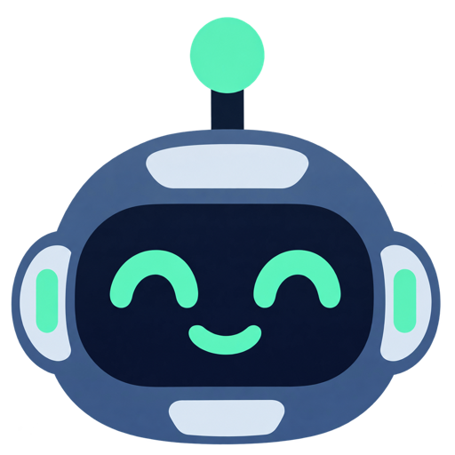

<div align="center">



<h1>Companion IA</h1>

**Tu compañero digital, gratis y de código abierto. Vos elegís cómo ejecutarlo, cómo configurarlo y qué puede hacer.**

<p>
  <a href="https://github.com/fabianfaaaal/companion-ia/releases"></a>
  <a href="https://github.com/fabianfaaaal/companion-ia/releases/tag/android-alpha-0.1.0"></a>
</p>

[English](README.md) · [Español](README_spanish.md)

[Requisitos](#requisitos-del-sistema) · [Primeros pasos](#primeros-pasos) · [Roadmap](#roadmap)

</div>

Companion IA busca darte un compañero digital con el que puedas contar. Te ayuda a aprender, registra lo que te importa y reúne modelos de IA y herramientas en un solo lugar. **Decile a Companion en lenguaje cotidiano qué querés lograr.** A medida que se incorporen capacidades, podés organizar el trabajo, hacerlo junto a Companion o delegarle un encargo.

Estudiá para un examen y retomá donde quedaste. Organizá referencias y desarrollá un diseño en conjunto. Pedí un archivo editable y revisá qué hizo Companion. Está previsto un diario personal opcional para volver a los avances, decisiones y experiencias que quieras conservar.

**La app de Windows y la de Android son gratis, sin suscripción a Companion.** Podés ejecutar modelos en tu PC con Ollama o conectar tu propia cuenta a una API externa opcional. Los cargos de una API dependen de su proveedor.

Vos controlás tus archivos personales y datos sensibles. Elegís a qué puede acceder Companion, qué guarda y si puede compartir información con un proveedor externo. La alpha de Android se conecta hoy a tu PC por la misma red Wi-Fi. El modelo se ejecuta en la PC.

## Qué podés probar hoy

| Función | Disponible en la versión preliminar |
| --- | --- |
| Chat con IA local | Conversá con Ollama, personalizá la personalidad de Companion y reabrí las conversaciones que elegiste guardar. |
| Memoria y contexto | Usá notas, fichas de contexto por palabras clave e historiales importados. Revisá las actualizaciones sugeridas antes de aceptarlas. |
| Voz y dictado | Grabá al pulsar un botón con Whisper y escuchá las respuestas con Piper o Qwen TTS experimental, según la compilación. |
| Archivo personal | Guardá fotos con descripción en Cinemateca, configurá recordatorios locales y creá o restaurá respaldos por carpetas. |
| Modelos y herramientas | Conectá una cuenta opcional de OpenAI o DeepSeek, o autorizá explícitamente una búsqueda web. |
| Companion en Android | Escaneá un QR y chateá con tu PC Windows desde la misma red Wi-Fi. |

Windows tiene una versión preliminar pública. Android tiene una alpha pública. El chat por Wi-Fi se verificó durante el desarrollo en un teléfono físico. Todavía falta la prueba de aceptación de la configuración completa en una PC Windows limpia. Linux está cubierto por CI y se prevé un paquete distribuible.

## Requisitos del sistema

### PC anfitriona

| Uso | Hardware y software |
| --- | --- |
| Abrir la versión preliminar de Windows | Windows de 64 bits y espacio para extraer el ZIP completo. Podés abrir la app sin GPU dedicada, micrófono ni modelo. Todavía falta medir el mínimo de CPU y RAM para la app sola. |
| Chat de texto local liviano | Empezá con **8 GB de RAM** y unos **8 GB libres en disco**, con un modelo chico como `qwen2.5:1.5b` en CPU. Ollama requiere **Windows 10 22H2 o posterior**. |
| Chat local y voz por turnos | Empezá con **16 GB de RAM** y unos **15 GB libres en disco**. Usá un micrófono para dictar y parlantes o auriculares para escuchar. Una GPU compatible puede acelerar la inferencia. |
| PC de referencia de desarrollo | **Ryzen 9 3900XT, 32 GB de RAM, RTX 3080 con 10 GB de VRAM.** En una prueba de desarrollo, `qwen3:4b` corrió íntegramente en GPU con un contexto de 4096 tokens. |
| Perfil objetivo para una PC dedicada | **32–64 GB de RAM**, **SSD de 1–2 TB** y **16–32 GB de VRAM**, según tus modelos y aplicaciones. Falta validar las cargas de trabajo. |

Las cifras de RAM y disco son orientativas. Ollama y las descargas requieren más espacio a medida que crece tu biblioteca de modelos. [Ollama para Windows](https://docs.ollama.com/windows)

### Cliente Android

- **Android 6.0 (API 23) o posterior**, según la configuración de compilación actual.
- **Cámara** para vincular por QR y **la misma red Wi-Fi** que la PC en la alpha actual.
- **PC Windows encendida** con versiones compatibles de Companion y Ollama. El teléfono envía mensajes y muestra las respuestas. La inferencia se ejecuta en la PC, así que el teléfono no necesita descargar modelos.

## Primeros pasos

1. Descargá el [ZIP de la versión preliminar para Windows](https://github.com/fabianfaaaal/companion-ia/releases), extraelo completo y abrí **CompanionIA.exe**.
2. Instalá Ollama y descargá un modelo. Empezá con `qwen2.5:1.5b` para chat de texto liviano.
3. Elegí **Detectar Ollama**, seleccioná el modelo y mandá un mensaje. Podés empezar con la memoria apagada.
4. Para conectar Android, abrí **Android** en la PC y generá un QR. En el teléfono, abrí **Ajustes → Escanear código QR**.

[Configuración de Windows y vinculación con Android](docs/primeros-pasos.md)

## Privacidad y control

- **Memoria opcional.** Elegí qué puede guardar, revisar y reutilizar Companion.
- **Modo privado.** Mantené el chat temporal y local. Este modo desactiva el acceso a la memoria guardada, la voz, los sensores, los proveedores externos y Android.
- **Servicios externos.** Habilitá los proveedores y herramientas que quieras usar.
- **Archivos locales.** El archivo personal actual se guarda sin cifrar. Usá datos sintéticos para probar la versión preliminar. El cifrado del archivo figura en el roadmap.

## Roadmap

| Hito | Alcance previsto |
| --- | --- |
| Configuración | Instalación limpia en Windows · configuración guiada · perfiles local, online e híbrido |
| Continuidad | Diario personal · retomar entre días · memoria editable · archivo cifrado |
| La Mente | Cronología legible · preguntar qué pasó · permisos · uso de tokens |
| Agentes | Asignar · programar · pausar · retomar · revisar · entregar · aprender de devoluciones |
| Aplicaciones | Texto → presentaciones → planillas → generación y edición de imágenes → Blender → video |
| Trabajo en conjunto | Instalar herramientas autorizadas · colaborar o delegar · revisar versiones y entregas |
| Android | Acceso directo con datos móviles cuando la red lo permite · estado de tareas · alertas · aprobaciones |
| Mantenimiento | Preparar actualizaciones · ejecutar pruebas · revisar antes de aplicar · revertir |

## Ejecutar desde el código

Usá **Python 3.12**, Ollama y un modelo descargado. Desde la raíz del repositorio en PowerShell:

```powershell
python -m venv .venv
.\.venv\Scripts\python.exe -m pip install -r requirements-build-windows.txt
$env:PYTHONPATH = "src"
.\.venv\Scripts\python.exe -m companion.desktop
```

Ejecutá el lector independiente o la suite de pruebas:

```powershell
powershell.exe -NoProfile -STA -File .\scripts\reader-windows.ps1
.\.venv\Scripts\python.exe -B -m unittest discover -s tests -v
```

## Documentación y ayuda

- [Primeros pasos](docs/primeros-pasos.md)
- [Configuración guiada, fichas y respaldos](docs/guided-preview.md)
- [Configuración de voz local](docs/voice-ready-preview.md)
- [Proveedores, cuentas e historiales](docs/providers-and-history.md)
- [Compilar Android desde el código](android/README.md)
- [Reportar un problema reproducible](https://github.com/fabianfaaaal/companion-ia/issues)

## Mantenimiento y licencia

Mantenido por [Fabián](https://github.com/fabianfaaaal) con ayuda de Codex. Se aceptan informes de errores reproducibles. Las contribuciones externas de código están en pausa.

Companion IA usa la licencia [Apache-2.0](LICENSE). Los modelos, las voces y las dependencias tienen sus propios términos. [Avisos de terceros](THIRD_PARTY_NOTICES.md)
